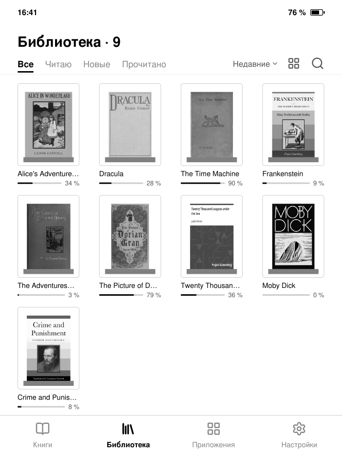
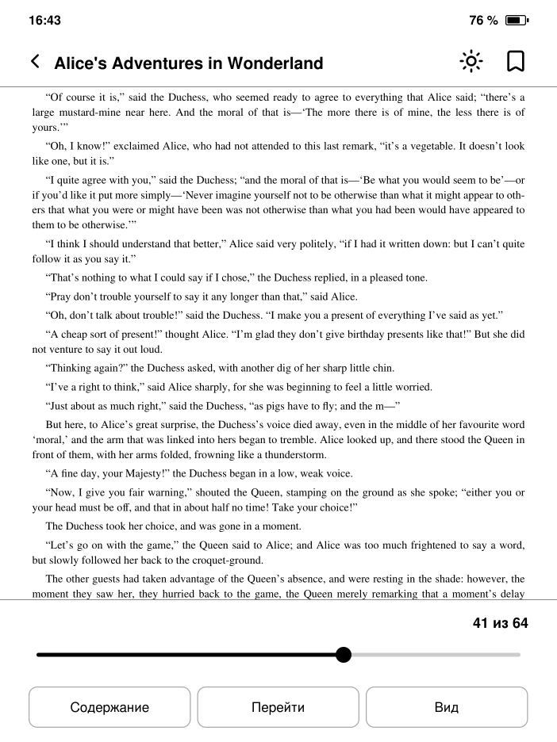
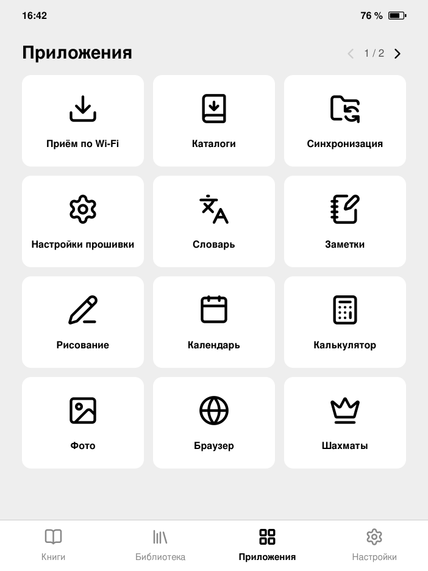
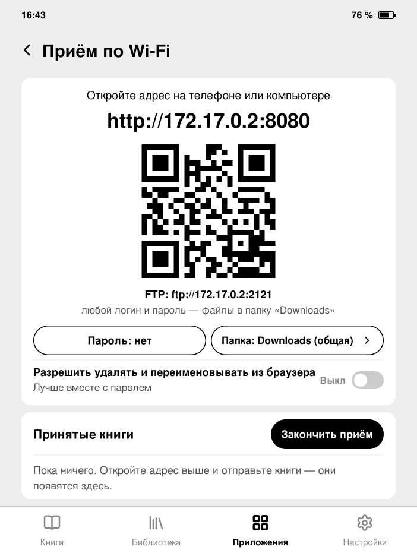
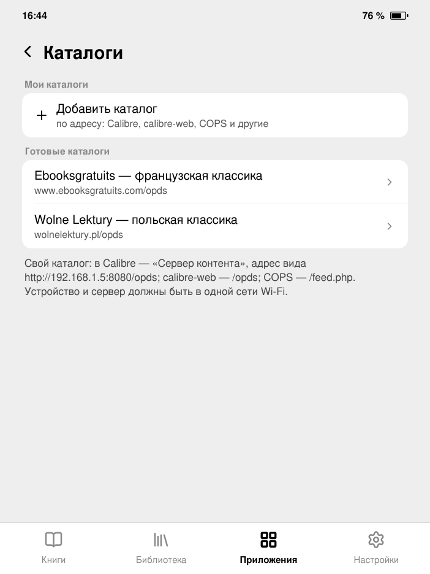
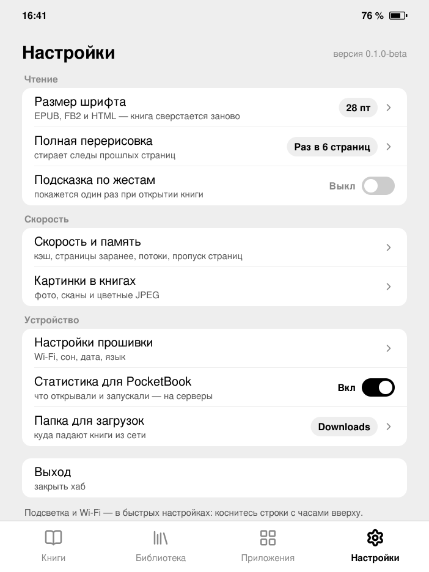

<div align="center">

# Washi

**A fast, calm home screen and reader for PocketBook e-readers**

[](https://github.com/Porfik/washi/releases)
[](LICENSE)


**English** · [Русский](README.ru.md)

  

</div>

> [!WARNING]
> **Beta.** Washi is an unofficial hobby project, not affiliated with PocketBook. The interface is
> in Russian for now. Replacing the home screen is at your own risk: read
> [Safety and rollback](#safety-and-rollback) first.

Washi replaces the stock PocketBook home screen with its own: your books, library, apps and
settings. It opens PDF, EPUB and FB2 in its own MuPDF-based reader, tuned for slow e-ink hardware;
other formats open in the stock reader. It can also receive books over Wi‑Fi, browse OPDS catalogs
and sync books and reading positions with a WebDAV or FTP folder.

## Why Washi

- **Fast where it counts.** Pages are rendered ahead on both CPU cores and cached, and a page turn shows the cached page right away. MuPDF carries 15 speed patches. Each is measured on a real device, and its output is compared pixel-for-pixel with the previous build ([docs/bench.md](docs/bench.md)).
- **Made for e-ink.** One action redraws only the area that changed, there are no animations, touch targets are large and grays match the panel's 16 levels.
- **Books over the network.** Send books from a phone or PC browser, browse OPDS catalogs, or sync with Nextcloud, Yandex Disk or any WebDAV or FTP folder.
- **Safe to try.** It runs as a regular app first. As the home screen it has a crash guard and a way back to the stock home screen without a PC.

## Screenshots

| Home | Library | Reader | Reader panel |
|:---:|:---:|:---:|:---:|
|  |  |  |  |
| **Apps** | **Receive over Wi‑Fi** | **OPDS catalogs** | **Settings** |
|  |  |  |  |

<sub>The books in the screenshots are public-domain editions from Project Gutenberg.</sub>

## Features

**Home screen**
- **Books:** the current book with its cover and progress, plus recently read books.
- **Library:** every book on the device as covers, a list or folders. You can filter (reading, new, finished), sort and search, and rename or delete books and folders.
- **Apps:** firmware apps and the hub's network pages.
- **Settings:** reading, speed and memory, the download folder, firmware settings, and a way back to the stock home screen.
- **Quick settings:** swipe down from the clock for frontlight, warmth, Wi‑Fi and a screen refresh.

**Reader** (PDF, EPUB, FB2, HTML)
- Tap zones, swipes and the page buttons turn pages. A panel gives the table of contents, bookmarks, go to page, links inside the PDF and a progress slider.
- View modes are remembered per book:
  - fit page, fit width or crop margins;
  - portrait, landscape or a two-page spread;
  - four contrast levels for pale scans.
- Brightness and warmth change by sliding along the left and right edges.

**Books over the network**
- **Receive over Wi‑Fi:** the screen shows an address and a QR code. Open it in a browser on a phone or PC to see the device's folders, create folders and upload books. Deleting and renaming from the browser only work with an on-device switch. An FTP server runs alongside; it can't delete, rename or overwrite.
- **Catalogs (OPDS):** browse sections, search, log in when a catalog needs it, download and open.
- **Sync:** connects to a WebDAV folder or an FTP folder. Books go from the server to the device. Reading positions and bookmarks are merged both ways.
- An optional password protects the receive page. Logins and passwords are stored encrypted with a key derived from the device serial number.

## Supported devices

| Device | Firmware | Status |
|---|---|---|
| PocketBook InkPad 3 (PB740) | U740.6.5.1379 | main development device |
| PocketBook InkPad 4 (PB743G) | U743g.6.8.4143 | works, same build |

Other devices on the B288 platform with firmware 6.x will probably work too, but nobody has tried.
If you try one, please open an issue with the result. Device details: [docs/device.md](docs/device.md).

## Installation

There are no prebuilt releases yet: build `washi.app` first (see
[Building from source](#building-from-source)). Then connect the device to a PC in USB storage
mode («PC link»).

1. **Try it as an app.** Copy `washi.app` into `applications/` on the device, unplug it and open *washi* from *Applications*. Nothing else on the device changes.
2. **Make it the home screen.** Copy the same file to `system/bin/bookshelf.app` and restart the device. The firmware runs `/mnt/ext1/system/bin/bookshelf.app`, if present, instead of its own home screen.

Settings, reading positions, covers and the log (`washi.log`) live in `washi/` at the root of the
device. Defaults and every option are described in [device/config.txt](device/config.txt).

## Safety and rollback

- **Crash guard.** If Washi fails to reach its first screen three starts in a row, the stock home screen starts instead. Delete `washi/home-fails` to try Washi again.
- **On the device:** *Settings → Stock home screen*. *Until restart* switches to the stock home screen once; *Permanently* removes the replacement.
- **From a PC:** delete `system/bin/bookshelf.app` and restart the device.
- Don't hold both page-turn buttons while powering on. On the InkPad 3 this starts the firmware update mode.
- Firmware updates may change how the home screen is started. Washi is tested only on the firmware versions listed above.

## Building from source

Everything builds inside a Docker image; nothing is installed on the host. The image contains
Ubuntu 22.04, CMake, Ninja, SDL2 and the [PocketBook SDK](https://github.com/pocketbook/SDK_6.3.0)
(branch `6.5`, GCC 6.3, glibc 2.23). It is built on the first run of `scripts/dev.sh`: about
0.7 GB to download, 3.8 GB on disk.

Download MuPDF 1.28.6 (`mupdf-1.28.6-source.tar.gz`, SHA256
`dc85000640a45d90ca9b77b061f6ca67cce0c4d4fbecf8819647baf573eef101`) from
[mupdf.com](https://mupdf.com/releases) and unpack it into `third_party/`. The build script applies
the patches from `patches/mupdf/`. Then:

```sh
scripts/dev.sh scripts/build-mupdf.sh arm       # MuPDF for the device
scripts/dev.sh scripts/build-mupdf.sh pc        # MuPDF for the PC version
scripts/dev.sh cmake -G Ninja -S . -B build/arm -DCMAKE_TOOLCHAIN_FILE=/work/cmake/pb740.cmake
scripts/dev.sh cmake --build build/arm          # → build/arm/washi.app
scripts/dev.sh cmake -G Ninja -S . -B build/pc
scripts/dev.sh cmake --build build/pc           # PC version (SDL2) for development
scripts/dev.sh ctest --test-dir build/pc        # tests
```

On the PC, `build/pc/washi` shows the device screen in a window; the `WASHI_*` variables are
described at the top of [src/platform/sdl.c](src/platform/sdl.c). `scripts/pb.sh` copies builds
to a connected device, shows its log and ejects it.

## Project layout

| Path | What's there |
|---|---|
| `src/platform/` | InkView on the device, SDL2 on the PC |
| `src/ui/` | the hub (home, library, apps, settings, network pages) and the reader |
| `src/doc/`, `src/render/` | documents, covers, background rendering |
| `src/net/` | Wi‑Fi receive (HTTP + FTP), OPDS, WebDAV/FTP sync |
| `src/base/` | settings, reading positions, bookmarks, encrypted secrets |
| `patches/mupdf/` | MuPDF speed patches |
| `docs/` | device notes, interface logic, speed measurements (in Russian) |

`washi-bench.app` runs speed tests on the device from `washi/bench.txt` (format in
[device/bench.txt](device/bench.txt)). Test books are not included; put your own PDFs into
`testdata/`.

## Contributing

Bug reports, device reports and pull requests are welcome. Code comments and the docs in `docs/`
are in Russian; issues in English are fine. For speed changes, include before/after numbers from
a device.

## License

Washi is free software under the [GNU Affero General Public License v3.0 or later](LICENSE).
The device build links MuPDF statically, which is also AGPL‑3.0.

Third-party components: MuPDF (AGPL‑3.0), Lucide icons (ISC), QR Code generator by Nayuki (MIT).
Fonts are taken from the device firmware at runtime and are not included. Details:
[docs/THIRD_PARTY.md](docs/THIRD_PARTY.md).

## Acknowledgements

- [MuPDF](https://mupdf.com) by Artifex, the rendering engine.
- [KOReader](https://github.com/koreader/koreader) and EinkHome, which showed that the PocketBook home screen can be replaced.
- The [PocketBook SDK](https://github.com/pocketbook/SDK_6.3.0).
- [Lucide](https://lucide.dev) icons and Nayuki's [QR Code generator](https://github.com/nayuki/QR-Code-generator).
