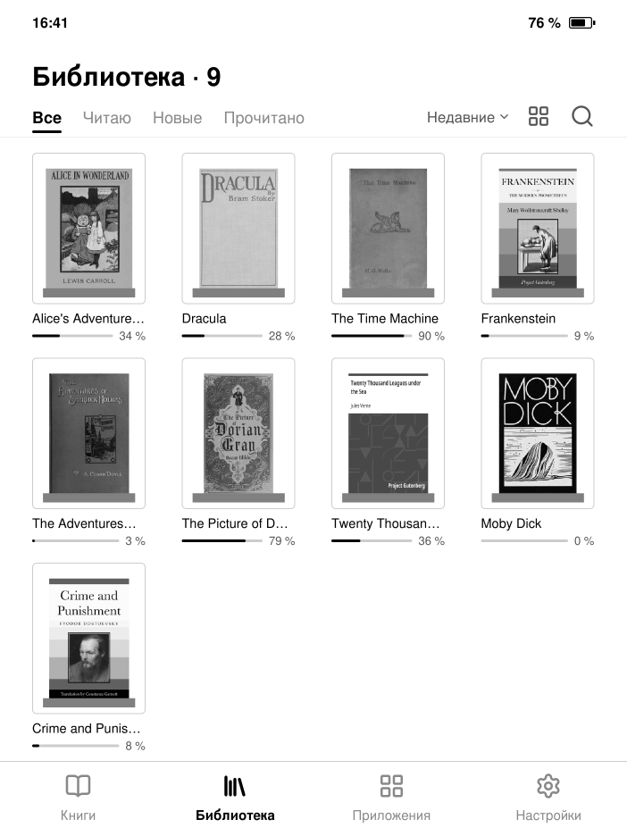
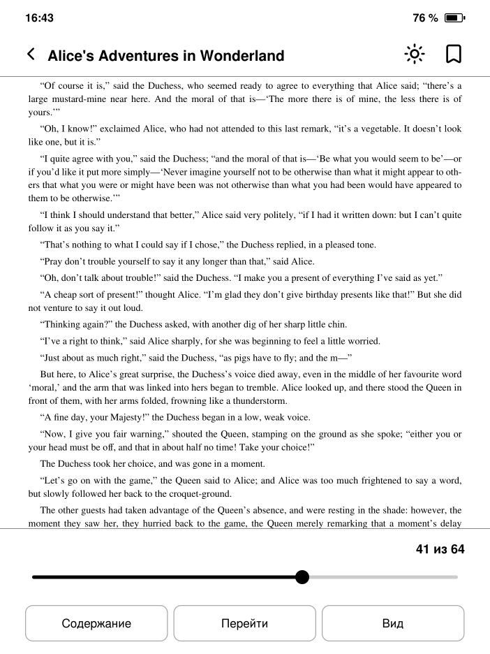
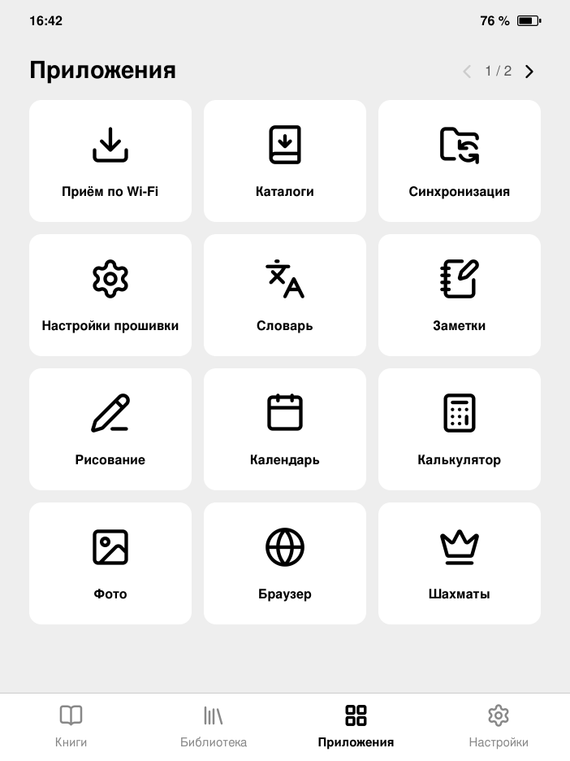
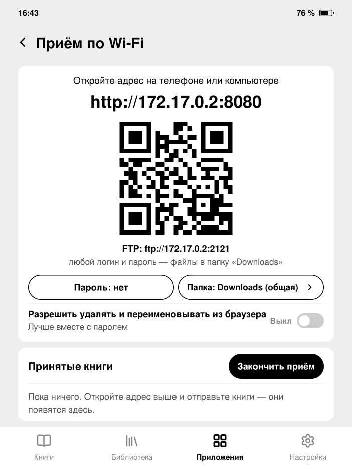
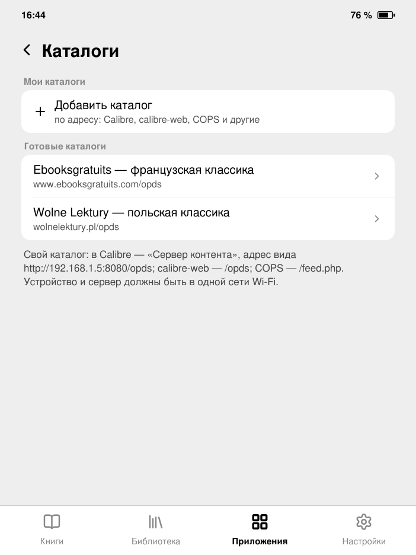
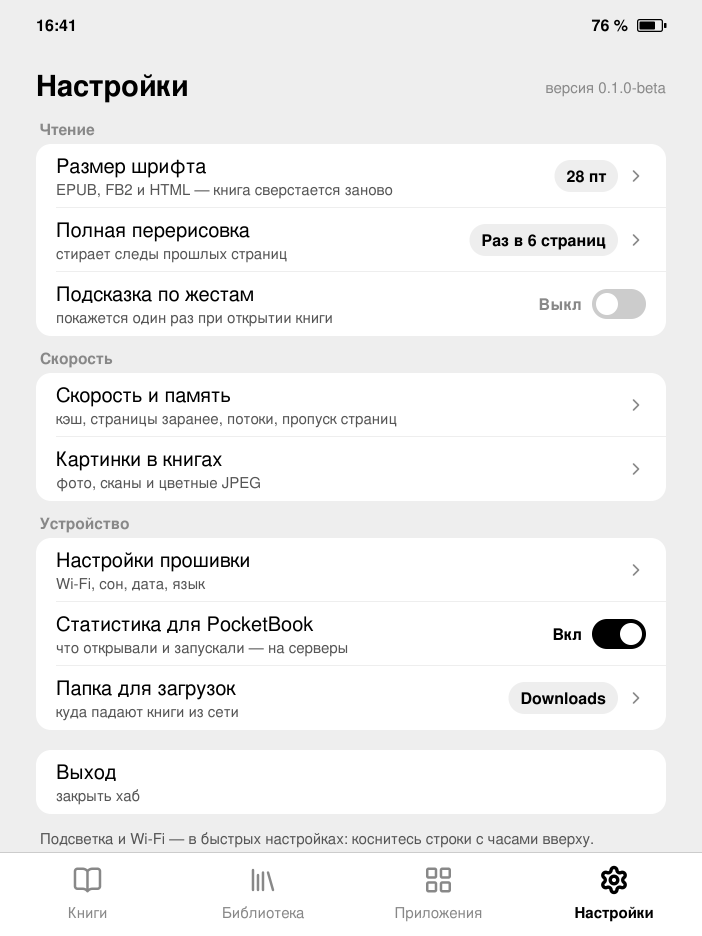

<div align="center">

# Washi

**Быстрый и спокойный главный экран и читалка для электронных книг PocketBook**

[](https://github.com/Porfik/washi/releases)
[](LICENSE)


[English](README.md) · **Русский**

  

</div>

> [!WARNING]
> **Бета-версия.** Washi — неофициальный любительский проект, к PocketBook отношения не имеет.
> Подмена главного экрана — на ваш риск: сначала прочитайте
> [Безопасность и откат](#безопасность-и-откат).

Washi заменяет штатный главный экран PocketBook своим: книги, библиотека, приложения и
настройки. PDF, EPUB и FB2 открывает своя читалка на MuPDF, настроенная под медленное железо
e-ink; остальные форматы — штатная. Ещё Washi принимает книги по Wi‑Fi, показывает каталоги OPDS
и синхронизирует книги и места чтения с папкой WebDAV или FTP.

## Почему Washi

- **Быстро там, где важно.** Страницы рисуются заранее на обоих ядрах и кэшируются, перелистывание сразу показывает готовую. В MuPDF 15 патчей скорости. Каждый замерен на настоящем устройстве, а его результат сверен попиксельно с прошлой сборкой ([docs/bench.md](docs/bench.md)).
- **Сделано для e-ink.** Одно действие перерисовывает только изменившуюся область, анимаций нет, касания крупные, оттенки ровно по 16 уровням экрана.
- **Книги по сети.** Отправка книг из браузера телефона или ПК, каталоги OPDS, синхронизация с Nextcloud, Яндекс Диском или любой папкой WebDAV или FTP.
- **Безопасно попробовать.** Сначала работает как обычное приложение. Как главный экран — с защитой от падений и возвратом к штатному экрану без компьютера.

## Скриншоты

| Главная | Библиотека | Читалка | Панель читалки |
|:---:|:---:|:---:|:---:|
|  |  |  |  |
| **Приложения** | **Приём по Wi‑Fi** | **Каталоги OPDS** | **Настройки** |
|  |  |  |  |

<sub>На скриншотах — книги из общественного достояния (Project Gutenberg).</sub>

## Возможности

**Главный экран**
- **Книги:** текущая книга с обложкой и прогрессом и недавно прочитанные.
- **Библиотека:** все книги устройства обложками, списком или папками. Можно фильтровать (читаю, новые, прочитано), сортировать и искать, переименовывать и удалять книги и папки.
- **Приложения:** приложения прошивки и сетевые страницы хаба.
- **Настройки:** чтение, скорость и память, папка загрузок, настройки прошивки и возврат к штатному главному экрану.
- **Быстрые настройки:** свайп вниз от часов — подсветка, теплота, Wi‑Fi и очистка экрана.

**Читалка** (PDF, EPUB, FB2, HTML)
- Листание касанием, свайпами и кнопками. Панель: содержание, закладки, переход на страницу, ссылки внутри PDF и ползунок.
- Вид запоминается для каждой книги:
  - по странице, по ширине или без полей;
  - книжная, альбомная ориентация или разворот на две страницы;
  - четыре уровня контраста для бледных сканов.
- Яркость и теплота меняются, если вести пальцем вдоль левого и правого края.

**Книги по сети**
- **Приём по Wi‑Fi:** на экране адрес и QR-код. В браузере телефона или ПК видны папки устройства: можно создавать папки и загружать книги. Удалять и переименовывать из браузера можно, только если это разрешено на самом устройстве. Рядом работает FTP-сервер; удалять, переименовывать и перезаписывать по FTP нельзя.
- **Каталоги (OPDS):** разделы, поиск, вход, если каталог его требует, скачивание и чтение.
- **Синхронизация:** с папкой WebDAV или FTP. Книги идут с сервера на устройство. Места чтения и закладки объединяются в обе стороны.
- Страницу приёма можно закрыть паролем. Логины и пароли хранятся зашифрованными ключом из серийного номера устройства.

## Устройства

| Устройство | Прошивка | Состояние |
|---|---|---|
| PocketBook InkPad 3 (PB740) | U740.6.5.1379 | основное устройство разработки |
| PocketBook InkPad 4 (PB743G) | U743g.6.8.4143 | работает, та же сборка |

Другие устройства на платформе B288 с прошивкой 6.x, скорее всего, тоже подойдут, но их никто не
проверял. Попробовали — расскажите в issue, что вышло. Подробности об устройствах —
[docs/device.md](docs/device.md).

## Установка

Готовых сборок пока нет: сначала соберите `washi.app` (см. [Сборка](#сборка)). Затем
подключите устройство к ПК в режиме накопителя («Подключение к ПК»).

1. **Попробовать как приложение.** Скопируйте `washi.app` в `applications/` на устройстве, отключите его и откройте *washi* в «Приложениях». Больше на устройстве ничего не меняется.
2. **Сделать главным экраном.** Скопируйте тот же файл в `system/bin/bookshelf.app` и перезапустите устройство. Прошивка запускает `/mnt/ext1/system/bin/bookshelf.app`, если он есть, вместо своего главного экрана.

Настройки, места чтения, обложки и лог (`washi.log`) лежат в папке `washi/` в корне устройства.
Настройки по умолчанию и описание каждой — в [device/config.txt](device/config.txt).

## Безопасность и откат

- **Защита от падений.** Если Washi трижды подряд не дошёл до первого экрана, вместо него запускается штатный главный экран. Чтобы снова пробовать Washi, удалите `washi/home-fails`.
- **С самого устройства:** «Настройки → Штатный главный экран». «До перезагрузки» — штатный экран один раз; «Насовсем» — подмена удаляется.
- **С компьютера:** удалите `system/bin/bookshelf.app` и перезапустите устройство.
- Не зажимайте обе кнопки листания при включении: на InkPad 3 это режим обновления прошивки.
- Обновление прошивки может поменять то, как запускается главный экран. Washi проверен только на прошивках из таблицы выше.

## Сборка

Всё собирается в Docker-образе, на хост ничего не ставится. В образе: Ubuntu 22.04, CMake,
Ninja, SDL2 и [PocketBook SDK](https://github.com/pocketbook/SDK_6.3.0) (ветка `6.5`, GCC 6.3,
glibc 2.23). Образ собирается при первом запуске `scripts/dev.sh`: около 0,7 ГБ загрузки,
3,8 ГБ на диске.

Скачайте MuPDF 1.28.6 (`mupdf-1.28.6-source.tar.gz`, SHA256
`dc85000640a45d90ca9b77b061f6ca67cce0c4d4fbecf8819647baf573eef101`) с
[mupdf.com](https://mupdf.com/releases) и распакуйте в `third_party/`. Патчи из `patches/mupdf/`
накладывает скрипт сборки. Затем:

```sh
scripts/dev.sh scripts/build-mupdf.sh arm       # MuPDF для устройства
scripts/dev.sh scripts/build-mupdf.sh pc        # MuPDF для версии на ПК
scripts/dev.sh cmake -G Ninja -S . -B build/arm -DCMAKE_TOOLCHAIN_FILE=/work/cmake/pb740.cmake
scripts/dev.sh cmake --build build/arm          # → build/arm/washi.app
scripts/dev.sh cmake -G Ninja -S . -B build/pc
scripts/dev.sh cmake --build build/pc           # версия на ПК (SDL2) для разработки
scripts/dev.sh ctest --test-dir build/pc        # тесты
```

На ПК `build/pc/washi` показывает экран устройства в окне; переменные `WASHI_*` описаны в начале
[src/platform/sdl.c](src/platform/sdl.c). `scripts/pb.sh` копирует сборки на подключённое
устройство, показывает его лог и извлекает его.

Новый патч MuPDF: правки прямо в `third_party/mupdf-1.28.6-source/`, затем
`scripts/dev.sh scripts/mupdf-patch.sh 0016-что-делает source/fitz/файл.c ...`. Каждую правку
сверяют попиксельно с прежней сборкой (`washi --bench ... --compare ФЛАГ` или
`scripts/render-set.sh` + `scripts/pgmdiff.py`) и замеряют на устройстве.

## Устройство проекта

| Путь | Что там |
|---|---|
| `src/platform/` | InkView на устройстве, SDL2 на ПК |
| `src/ui/` | хаб (главная, библиотека, приложения, настройки, сетевые страницы) и читалка |
| `src/doc/`, `src/render/` | документы, обложки, отрисовка в фоне |
| `src/net/` | приём по Wi‑Fi (HTTP + FTP), OPDS, синхронизация WebDAV/FTP |
| `src/base/` | настройки, места чтения, закладки, шифрование |
| `patches/mupdf/` | патчи скорости MuPDF |
| `docs/` | устройство, логика интерфейса, замеры скорости |

`washi-bench.app` гоняет замеры на устройстве по `washi/bench.txt` (формат — в
[device/bench.txt](device/bench.txt)). Тестовых книг в репозитории нет; кладите свои PDF в
`testdata/`.

| Скрипт | Что делает |
|---|---|
| `dev.sh` | оболочка или команда в контейнере `washi-dev` |
| `build-mupdf.sh` | MuPDF: `pc`, `pc-prof` (callgrind), `pc-tsan` (гонки), `arm` |
| `mupdf-patch.sh` | новый патч MuPDF из правок в `third_party/` |
| `pb.sh` | устройство: установка, логи, извлечение |
| `render-set.sh`, `pgmdiff.py` | набор страниц в PGM и сравнение двух сборок |
| `profile.sh` | callgrind одной книги на ПК |
| `corpus-prof.sh`, `cg-sum.py` | callgrind всего `testdata/` и сводка по функциям |
| `prof-report.py` | профиль с устройства (`--prof`) → функции по `nm` той же сборки |
| `pgm2png.py` | PGM → PNG для просмотра |

## Участие

Сообщения об ошибках, отчёты с других устройств и pull request'ы приветствуются. Для изменений
скорости приложите замеры «до» и «после» с устройства.

## Лицензия

Washi — свободная программа под [GNU Affero General Public License v3.0 или новее](LICENSE).
Сборка для устройства статически включает MuPDF, который тоже под AGPL‑3.0.

Сторонние компоненты: MuPDF (AGPL‑3.0), значки Lucide (ISC), QR Code generator от Nayuki (MIT).
Шрифты берутся из прошивки устройства при запуске и в проект не входят. Подробнее —
[docs/THIRD_PARTY.md](docs/THIRD_PARTY.md).

## Благодарности

- [MuPDF](https://mupdf.com) от Artifex — движок отрисовки.
- [KOReader](https://github.com/koreader/koreader) и EinkHome — показали, что главный экран PocketBook можно заменить.
- [PocketBook SDK](https://github.com/pocketbook/SDK_6.3.0).
- Значки [Lucide](https://lucide.dev) и [QR Code generator](https://github.com/nayuki/QR-Code-generator) от Nayuki.
